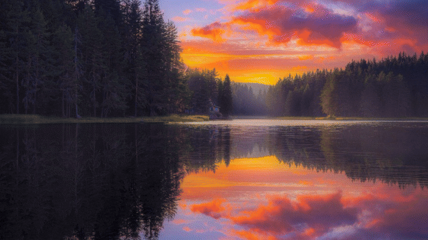
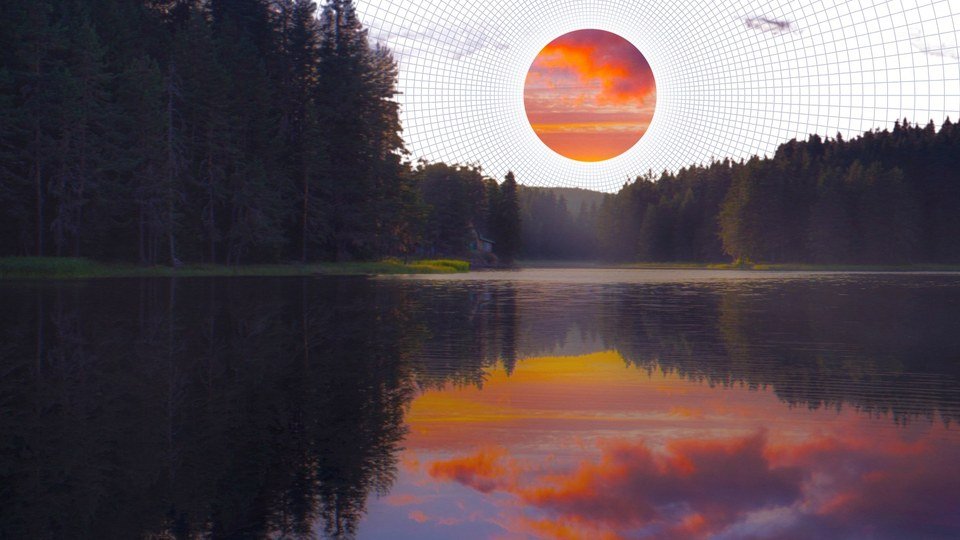
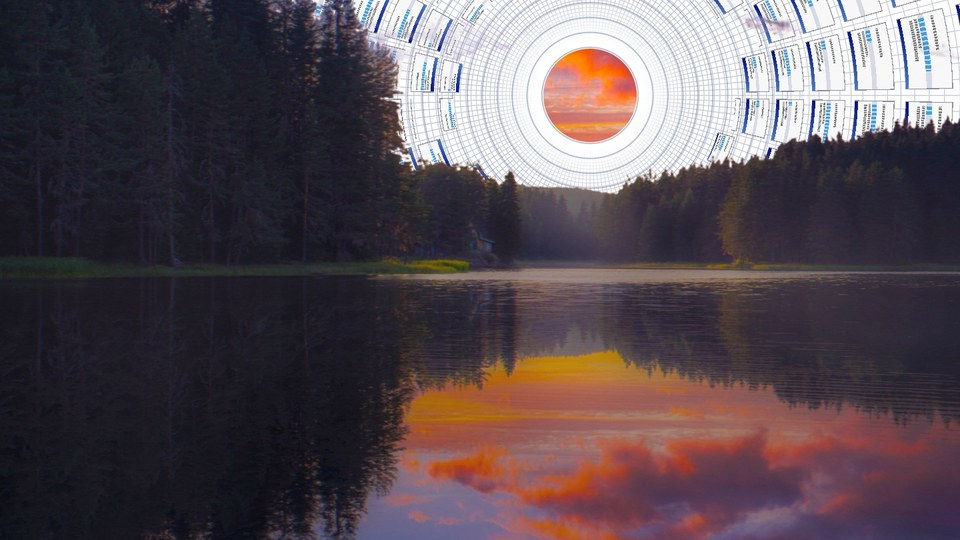
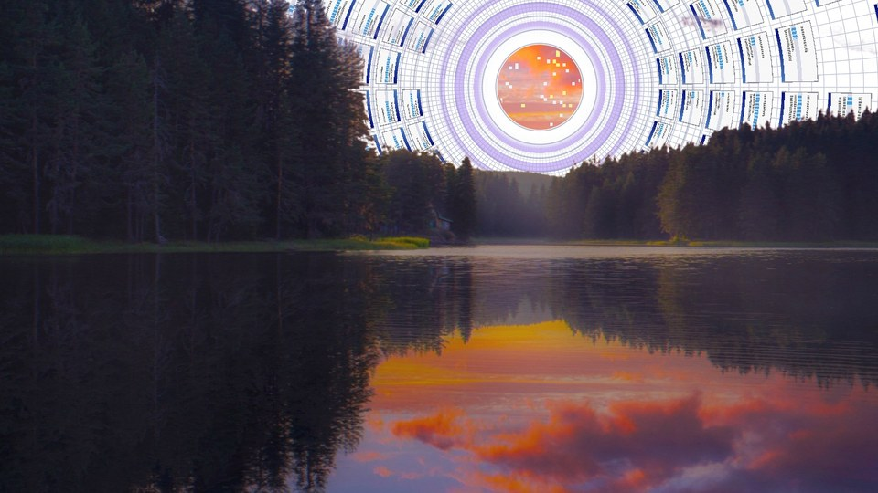
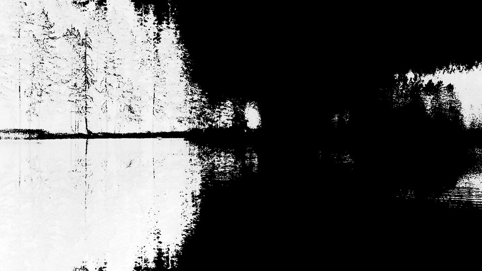
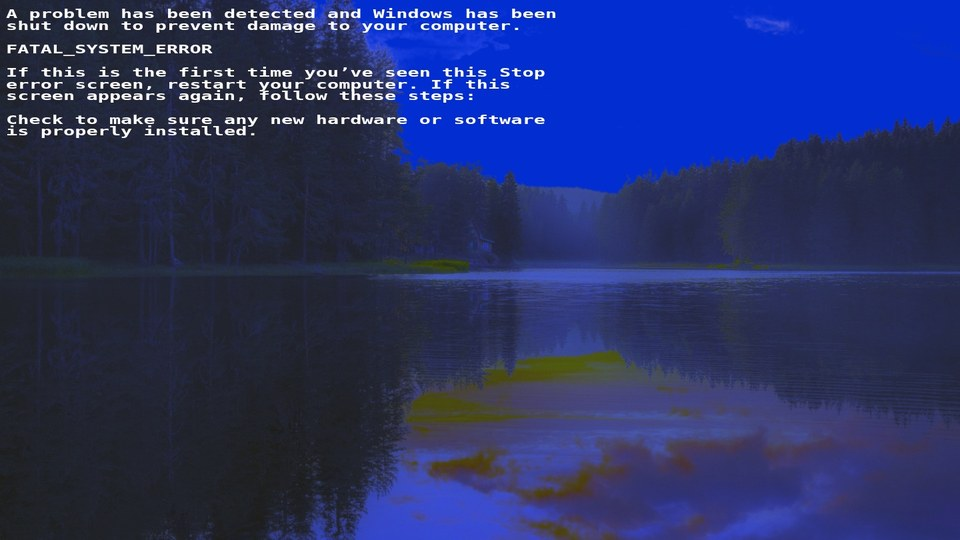
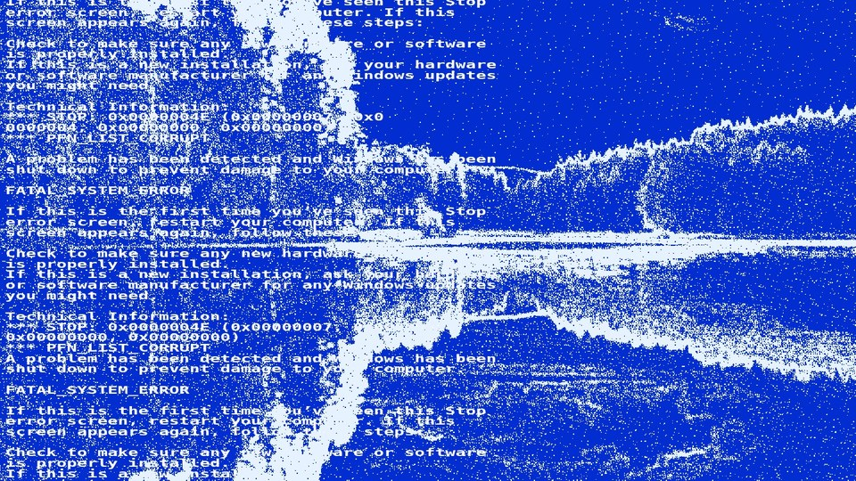
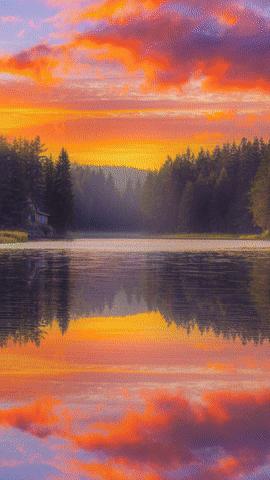

<div align="center">

# boot-effect

**A procedural boot intro for any photograph.**<br>
It finds the sky, grows a polar grid out of it, and cuts to a crash screen.<br>
One image, one WebGL shader, no dependencies.

[Live demo](https://adityabhatnagar1.github.io/boot-effect/) &nbsp;·&nbsp; [Playground](https://adityabhatnagar1.github.io/boot-effect/playground.html) &nbsp;·&nbsp; [Docs](https://adityabhatnagar1.github.io/boot-effect/docs.html) &nbsp;·&nbsp; [How it works](https://adityabhatnagar1.github.io/boot-effect/how-it-works.html)

<a href="https://adityabhatnagar1.github.io/boot-effect/playground.html">
  
</a>

<sub>Click the animation to run it live. The same effect, rendered by the library, 8.3 seconds.</sub>

</div>

## Scrub it

Every frame has its own link. These open the playground paused on that frame, where you can step through, change the fit and scale, or load your own photograph.

<table>
  <tr>
    <td align="center"><a href="https://adityabhatnagar1.github.io/boot-effect/playground.html?frame=40"></a><br><sub>040 · disc closes in</sub></td>
    <td align="center"><a href="https://adityabhatnagar1.github.io/boot-effect/playground.html?frame=90"></a><br><sub>090 · dialog tiles</sub></td>
    <td align="center"><a href="https://adityabhatnagar1.github.io/boot-effect/playground.html?frame=152"></a><br><sub>152 · violet rings</sub></td>
  </tr>
  <tr>
    <td align="center"><a href="https://adityabhatnagar1.github.io/boot-effect/playground.html?frame=205"></a><br><sub>205 · hard cut</sub></td>
    <td align="center"><a href="https://adityabhatnagar1.github.io/boot-effect/playground.html?frame=217"></a><br><sub>217 · ghost under blue</sub></td>
    <td align="center"><a href="https://adityabhatnagar1.github.io/boot-effect/playground.html?frame=244"></a><br><sub>244 · speckle</sub></td>
  </tr>
</table>

Try a few looks: [phone-shaped box](https://adityabhatnagar1.github.io/boot-effect/playground.html?shape=phone) · [whole photo, letterboxed](https://adityabhatnagar1.github.io/boot-effect/playground.html?fit=contain) · [half speed, larger effect](https://adityabhatnagar1.github.io/boot-effect/playground.html?speed=0.5&scale=1.35) · [looping](https://adityabhatnagar1.github.io/boot-effect/playground.html?loop=1).

<div align="center">
  <a href="https://adityabhatnagar1.github.io/boot-effect/playground.html?shape=phone">
    
  </a>
  <br><sub>The same sequence in a 9:16 box. The shape follows the window.</sub>
</div>

## Use it

```html
<div id="intro"></div>
<script src="https://cdn.jsdelivr.net/gh/adityabhatnagar1/boot-effect@v1.0.0/dist/boot-effect.js"></script>
<script>
  new BootEffect("#intro", {
    photo: "sunset.jpg",
    sky: { mode: "warm", horizon: 0.49 },
    onComplete: () => document.body.classList.add("ready")
  });
</script>
```

Or from npm:

```sh
npm install boot-effect
```

```js
import BootEffect from "boot-effect";

const intro = new BootEffect(document.body, {
  photo: "/hero.jpg",
  layout: "fullscreen",
  hideOnComplete: true
});
intro.done.then((fx) => fx.destroy());
```

The element you pass becomes the stage. With the default layout it takes a 16:9 shape in landscape windows and 9:16 in portrait ones, and the photograph is cropped to follow the sky.

## Your own photograph

Any photograph works. The grid grows out of the sky, so the library has to find it, and `sky: "auto"` chooses between three rules:

| Mode | For | How it decides |
| --- | --- | --- |
| `blue` | Clear daytime sky | Blue-dominant, bright pixels |
| `haze` | Fog, overcast, milky sky | Bright and locally smooth pixels |
| `warm` | Sunrise, sunset, dusk | Orange, pink and violet pixels plus pale glow, connected to the top edge |

If the sky meets water, set `horizon`. A reflection of the sky is bright and colourful too, and without a horizon it would be turned into grid as well. The [playground](https://adityabhatnagar1.github.io/boot-effect/playground.html) lets you load a file, see what was detected, and copy the options.

The photograph is the only source of detail. The demo photograph is 2576 × 1449; for large displays, give it as many pixels as you can.

## Options at a glance

| Option | Default | |
| --- | --- | --- |
| `photo` | required | URL, image, bitmap or canvas, or `{ default, portrait, landscape }` |
| `autoplay` | `true` | Start when the photograph is ready |
| `loop` | `false` | Restart after the last frame |
| `layout` | `"inline"` | `"inline"`, `"fullscreen"`, or `{ position, anchor, width, height, … }` |
| `fit` | `"cover"` | `"cover"`, `"contain"` or `"fill"` |
| `sky` | `"auto"` | `"auto"`, `"blue"`, `"haze"`, `"warm"` or `{ mode, horizon, connected, … }` |
| `effectScale` | `1` | Multiplier on the automatic effect size |
| `respectReducedMotion` | `true` | Skip the animation for visitors who prefer reduced motion |
| `fallback` | `"photo"` | Without WebGL, show the still photograph |

Methods: `play`, `pause`, `stop`, `restart`, `skip`, `seek`, `setOptions`, `setLayout`, `analysis`, `snapshot`, `destroy`. Everything is in the [documentation](https://adityabhatnagar1.github.io/boot-effect/docs.html), and the typings ship in [`dist/boot-effect.d.ts`](dist/boot-effect.d.ts).

## How it works

There is no video. On load the library analyses the photograph on a canvas, finds the sky and the largest circle that fits inside it, and uploads the photograph and the analysis as textures. Each of the 250 frames is then one full-screen pass of one fragment shader, driven by a small table of keyframes. [How it works](https://adityabhatnagar1.github.io/boot-effect/how-it-works.html) walks through the analysis, the log-polar grid, the timeline and the playback loop.

## Repository

```
src/            library source and the fragment shader
dist/           built library and typings (committed, served by the CDN link above)
site/           the website: landing page, playground, docs, how it works
examples/       a minimal HTML page and a React wrapper
scripts/        build, check and local server
tools/          renders the README animations and site images from the real library
```

```sh
npm run build   # src/ → dist/, and a copy into site/lib/
npm run check   # build, then verify the bundle parses and exposes the public API
npm run dev     # build, then serve the site on http://localhost:4173
```

The site deploys to GitHub Pages from the workflow in `.github/workflows/pages.yml`. In the repository settings, set Pages to deploy from GitHub Actions.

`tools/render_media.py` regenerates the animations and frames in `site/assets` (it needs Python with Playwright and Pillow, plus ffmpeg).

## Credits and licence

Code is [MIT](LICENSE) licensed. The demonstration photograph, `site/assets/lake.jpg`, is not part of that licence. The website uses a Latin subset of [Lora](https://github.com/cyrealtype/Lora-Cyrillic), licensed under the SIL Open Font License 1.1.

Made by [Aditya Bhatnagar](https://adityabhatnagar.is-a.dev).
# boot-effect
